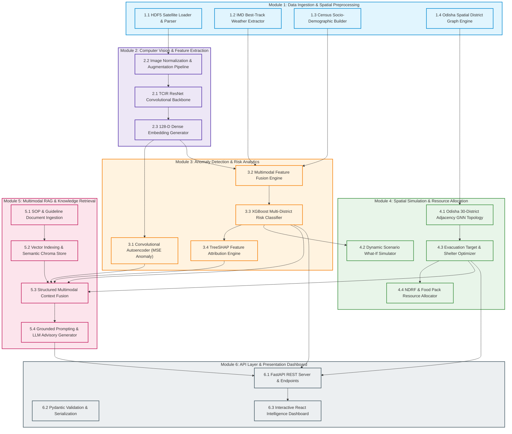
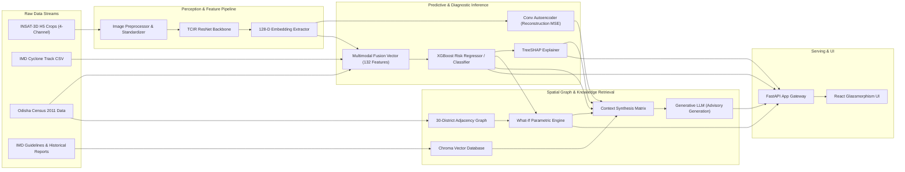
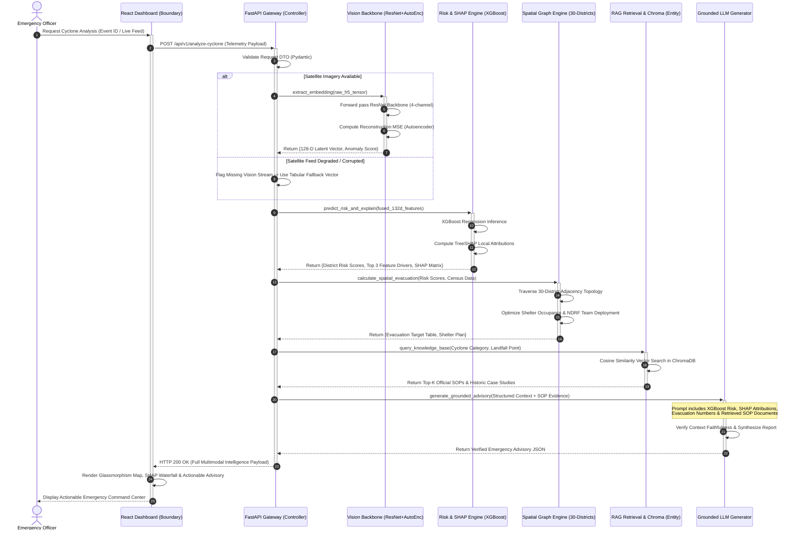

# IDMAP: Module Decomposition Diagram & Data Documentation

> **Document Type:** Software Engineering Architecture & Data Specification  
> **System:** IDMAP (Intelligent Disaster Mapping & Advisory Platform)  
> **Architecture Paradigm:** Layered Modular Multimodal AI & Spatial RAG Architecture  

---

## 1. Software Engineering Principles in Module Decomposition

The IDMAP architecture is engineered following classic and modern Software Engineering (SE) design principles:

1. **Separation of Concerns (SoC):** Distinct operational domains—Satellite Imagery Preprocessing, Deep Learning Vision Backbones, Spatial Graph Computations, Vector Retrieval, Agentic Decision Logic, and REST API Delivery—are decoupled into isolated modules.
2. **High Cohesion & Low Coupling:** Each sub-module encapsulates a single, tightly defined responsibility with minimal inter-module dependencies via standardized data transfer interfaces (Pydantic models, NumPy tensors, Pandas DataFrames).
3. **Information Hiding & Encapsulation:** Internal model weights, feature extraction pipelines, and raw vector index mechanics are hidden behind well-defined functional interfaces and tool registries.
4. **Single Responsibility Principle (SRP):** Each function performs one transformation or inference task (e.g., extracting 128-dim embeddings vs. computing SHAP local feature attributions).
5. **Open/Closed Principle (OCP):** New sensor inputs (e.g., radar, drone imagery) or LLM backends can be added via plugin interfaces without modifying existing evaluation pipelines.

---

## 2. Module Decomposition Diagram

### 2.1 High-Level Hierarchical Decomposition (Mermaid Code)



---

### 2.2 Detailed Structural & Component Interaction Diagram



---

## 3. Detailed Functional & Sub-Functional Breakdown

### Module 1: Data Ingestion & Spatial Preprocessing
| Sub-Module / Component | Primary Function | Sub-Functions | Inputs | Outputs |
| :--- | :--- | :--- | :--- | :--- |
| **`prepare_dataset.py`** | Ingest and inspect raw satellite data | `load_h5_file()`, `extract_channels()`, `validate_tensor_integrity()`, `partition_dataset()` | Raw `.h5` files (IR, Water Vapor, Visible) | 4D Tensor `(N, C, H, W)`, Metadata Dict |
| **`fetch_imd_besttrack.py`** | Parse meteorological track files | `download_tracks()`, `clean_wind_pressure()`, `interpolate_cyclone_trajectory()` | IMD Best-Track CSV / Text logs | Cleaned Cyclone Metrics Table (Wind, Pressure, Speed) |
| **`build_odisha_district_population.py`** | Standardize district census metrics | `load_census_tables()`, `compute_vulnerability_index()`, `calculate_coastal_proximity()` | Census 2011 District Demographics | Standardized District Feature Matrix (Pop, Density, Coastal km) |
| **`build_odisha_district_graph.py`** | Build topological district graph | `construct_adjacency_matrix()`, `compute_edge_weights()`, `export_networkx_graph()` | Boundary shapefiles / Adjacency lists | Node Features ($30 \times F$), Adjacency Matrix ($30 \times 30$) |

---

### Module 2: Computer Vision & Feature Extraction
| Sub-Module / Component | Primary Function | Sub-Functions | Inputs | Outputs |
| :--- | :--- | :--- | :--- | :--- |
| **`backbone.py`** | TCIR ResNet Feature Backbone | `ConvBlock()`, `ResidualBlock()`, `GlobalAvgPool2d()`, `extract_dense_embedding()` | Preprocessed Satellite Tensor `(B, 4, 201, 201)` | 128-dimensional dense feature embedding $\mathbf{z}_{cv} \in \mathbb{R}^{128}$ |
| **`pretrain_tcir_backbone.py`** | Train vision representation on TCIR | `build_dataloader()`, `compute_contrastive_loss()`, `run_training_epoch()`, `checkpoint_model()` | TCIR Benchmark Satellite Image Batches | Trained PyTorch weights checkpoint (`tcir_backbone.pth`) |

---

### Module 3: Anomaly Detection & Risk Analytics
| Sub-Module / Component | Primary Function | Sub-Functions | Inputs | Outputs |
| :--- | :--- | :--- | :--- | :--- |
| **`anomaly_autoencoder/`** | Detect structural satellite anomalies | `encoder_forward()`, `decoder_forward()`, `compute_reconstruction_mse()`, `flag_anomaly()` | 128-D embedding or 4D Tensor | Reconstruction error $\text{MSE}$, Binary Anomaly Flag ($0/1$) |
| **`feature_fusion/`** | Multi-modal feature alignment | `align_temporal_stamps()`, `concatenate_modalities()`, `impute_missing_values()`, `standardize_matrix()` | $\mathbf{z}_{cv}$, IMD metrics, District indicators | Unified Feature Matrix $\mathbf{X}_{fused} \in \mathbb{R}^{N \times 132}$ |
| **`risk_xgboost/model.py`** | Predict multi-district cyclone risk | `train_xgb_regressor()`, `predict_risk_score()`, `evaluate_metrics()` | Fused Feature Matrix $\mathbf{X}_{fused}$ | District Risk Level, Impact Severity Score ($0.0 - 1.0$) |
| **`risk_xgboost/shap_explainer.py`** | Compute feature attributions | `initialize_tree_explainer()`, `calculate_shap_values()`, `extract_top_k_drivers()`, `generate_waterfall_plot()` | Trained XGBoost Model, Sample Vector | SHAP Attribution Array $\boldsymbol{\phi}_i$, Top 5 Risk Driver Ranking |

---

### Module 4: Spatial Simulation & Resource Allocation
| Sub-Module / Component | Primary Function | Sub-Functions | Inputs | Outputs |
| :--- | :--- | :--- | :--- | :--- |
| **`whatif_engine.py`** | Simulate parametric shift scenarios | `adjust_wind_speed()`, `shift_landfall_point()`, `simulate_rainfall_surge()`, `recompute_projected_risk()` | Base Scenario Parameters, Delta Multipliers | Projected Risk Scores across all 30 Odisha Districts |
| **`resource_planner.py`** | Optimize evacuation & asset distribution | `calculate_evacuation_target()`, `allocate_shelter_capacity()`, `optimize_ndrf_teams()`, `estimate_relief_rations()` | District Vulnerability, Population, Risk Scores | Evacuation Plan Table (People, Shelters, NDRF, Food Packs) |
| **`unified_survey.py`** | Multi-district comprehensive audit | `aggregate_district_risk()`, `rank_priority_zones()`, `export_survey_report()` | 30 District Status Vectors | Consolidated District Emergency Matrix |

---

### Module 5: Multimodal RAG & Knowledge Retrieval
| Sub-Module / Component | Primary Function | Sub-Functions | Inputs | Outputs |
| :--- | :--- | :--- | :--- | :--- |
| **`ingestion.py`** | Ingest SOPs & Historical Case Studies | `load_pdf_documents()`, `clean_text_corpus()`, `semantic_chunking()`, `attach_rich_metadata()` | IMD Disaster Manuals, OSDMA Guidelines, Past Reports | Chunk List with Metadata (Year, Cyclone, Category, Source) |
| **`vector_store.py`** | Vector Indexing & Semantic Search | `generate_embeddings()`, `create_collection()`, `query_vector_store()`, `filter_by_metadata()` | Query Strings, Document Chunks | Top-$K$ Semantically Relevant Chunks with Cosine Scores |
| **`fusion_context.py`** | Formulate grounded prompt payload | `serialize_model_predictions()`, `format_district_tables()`, `inject_retrieved_evidence()`, `assemble_context_block()` | CV Anomaly, XGB Risk, SHAP Attributions, Top-$K$ Chunks | Grounded Context Prompt Buffer |
| **`prompts.py`** | Enforce grounded response generation | `build_system_directive()`, `format_advisory_template()`, `execute_llm_inference()`, `validate_citation_faithfulness()` | Structured Context + User Query | Verified Emergency Advisory with Traceable Citations |

---

### Module 6: Service API & Presentation Layer
| Sub-Module / Component | Primary Function | Sub-Functions | Inputs | Outputs |
| :--- | :--- | :--- | :--- | :--- |
| **`backend/main.py`** | Expose REST endpoints | `predict_risk_endpoint()`, `generate_advisory_endpoint()`, `simulate_whatif_endpoint()`, `get_district_graph_endpoint()` | JSON Requests (Parameters, Scenario Shifts) | JSON Responses (Predictions, SHAP Values, Advisories) |
| **`frontend/src/App.jsx`** | Render interactive command center | `render_overview()`, `render_shap_waterfall()`, `render_whatif_simulator()`, `render_district_map()` | API State, Live Telemetry | Interactive Visual Dashboard |

---

## 4. Comprehensive Data Documentation & Data Dictionary

### 4.1 Data Flow Sequence
```
[Raw HDF5 + IMD CSV] ──► (Preprocessing) ──► [Tensor: 4 x 201 x 201]
                                                    │
                                                    ▼
                                           [CV Backbone: ResNet]
                                                    │
                                                    ▼
                                          [128-D Image Embedding]
                                                    │
                                 ┌──────────────────┴──────────────────┐
                                 ▼                                     ▼
                     [Autoencoder: Anomaly MSE]         [Feature Fusion: 132-D Vector]
                                                                       │
                                                                       ▼
                                                             [XGBoost: Risk Score]
                                                                       │
                                                                       ▼
                                                            [TreeSHAP: Explanations]
                                                                       │
                                                                       ▼
[Chroma Knowledge Chunks] ──► [Multimodal Fusion Context Matrix] ──────┘
                                        │
                                        ▼
                            [LLM Grounded Generator]
                                        │
                                        ▼
                           [Actionable Advisory Report]
```

---

### 4.2 Data Entity Dictionary

#### Entity 1: Raw Satellite Image Tensor (`tcir_satellite_tensor`)
| Field Name | Type | Unit / Format | Description | Constraints / Range |
| :--- | :--- | :--- | :--- | :--- |
| `batch_id` | String | UUID | Unique sample identifier | Non-null |
| `channel_0_ir` | Float32 Tensor | Kelvin ($K$) | Infrared Channel (Cloud-top temperature) | $[160.0, 330.0]$ |
| `channel_1_wv` | Float32 Tensor | Kelvin ($K$) | Water Vapor Channel (Tropospheric moisture) | $[180.0, 300.0]$ |
| `channel_2_vis`| Float32 Tensor | Albedo / Reflectance | Visible Channel (Daytime cloud optical depth) | $[0.0, 1.0]$ |
| `channel_3_pmw`| Float32 Tensor | Kelvin ($K$) | Passive Microwave (Deep convective precipitation) | $[100.0, 320.0]$ |
| `dimensions` | Tuple | $(4, 201, 201)$ | Standardized spatial crop around cyclone center | Fixed dimensions |

#### Entity 2: Vision Embedding (`cv_latent_embedding`)
| Field Name | Type | Unit / Format | Description | Constraints / Range |
| :--- | :--- | :--- | :--- | :--- |
| `embedding_vector` | Float32 Array | Dense Vector | ResNet bottleneck dense latent representation | Length $= 128$, $\ell_2$-normalized |
| `reconstruction_mse` | Float32 | MSE Loss | Autoencoder image reconstruction error | $\ge 0.0$ (High values flag anomalies) |
| `anomaly_flag` | Boolean | $0 \text{ or } 1$ | Flag for irregular cloud vortex / uncharacteristic cyclone | Threshold-based ($\ge \tau$) |

#### Entity 3: Fused Master Feature Vector (`fused_tabular_instance`)
| Field Name | Type | Unit / Format | Description | Constraints / Range |
| :--- | :--- | :--- | :--- | :--- |
| `cv_features[0..127]` | Float32[128] | Latent features | Dense representation from TCIR backbone | Continuous |
| `central_pressure` | Float32 | $\text{hPa}$ | Minimum central atmospheric pressure | $[880.0, 1020.0]$ |
| `max_sustained_wind`| Float32 | Knots / $\text{km/h}$ | Maximum 3-minute sustained surface wind speed | $[25.0, 180.0]$ |
| `forward_speed` | Float32 | $\text{km/h}$ | Translation speed of storm eye | $[0.0, 60.0]$ |
| `coastal_distance` | Float32 | $\text{km}$ | Orthogonal distance to Odisha coastline | $[0.0, 800.0]$ |

#### Entity 4: District Graph Topology Node (`odisha_district_node`)
| Field Name | Type | Unit / Format | Description | Constraints / Range |
| :--- | :--- | :--- | :--- | :--- |
| `district_id` | Integer | ID $[0..29]$ | Unique identifier for Odisha's 30 districts | $[0, 29]$ |
| `district_name` | String | Proper Noun | Official administrative district name (e.g., Puri, Balasore) | Valid Odisha district |
| `census_population` | Integer | Count | Total district population (Census 2011) | $> 0$ |
| `pucca_house_ratio` | Float32 | Ratio $[0.0 - 1.0]$ | Proportion of resilient concrete housing structures | $[0.0, 1.0]$ |
| `shelter_count` | Integer | Count | Total registered Cyclone Shelters (MCS) | $\ge 0$ |
| `adjacency_list` | List[Integer] | District IDs | Bordering neighboring districts for evacuation routing | Valid node references |

#### Entity 5: Predictive Risk & Explainability Output (`risk_inference_payload`)
| Field Name | Type | Unit / Format | Description | Constraints / Range |
| :--- | :--- | :--- | :--- | :--- |
| `district_id` | Integer | ID | Target district | $[0, 29]$ |
| `predicted_risk_score` | Float32 | Normalized $[0.0 - 1.0]$| XGBoost calculated composite vulnerability index | $[0.0, 1.0]$ |
| `risk_category` | Enum | Categorical | Severity level: `Low`, `Moderate`, `Severe`, `Extreme` | 4 Classes |
| `shap_attributions` | Dict[str, float]| Log-odds impact | Additive feature contributions $\phi_i$ to final risk | $\sum \phi_i = f(x) - \mathbb{E}[f(x)]$ |
| `top_risk_drivers` | List[String] | Feature Names | Top 3 primary physical factors driving risk | Formatted labels |

#### Entity 6: Resource Planning & Evacuation Allocation (`resource_plan_payload`)
| Field Name | Type | Unit / Format | Description | Constraints / Range |
| :--- | :--- | :--- | :--- | :--- |
| `evacuation_target` | Integer | Persons | Calculated population required to evacuate within 36h | $\le \text{population}$ |
| `shelter_occupancy_rate`| Float32 | Percentage | Projected shelter capacity utilization | $[0.0, 100.0\%]$ |
| `ndrf_teams_deployed` | Integer | Team Count | Recommended National Disaster Response Force teams | $[0, 50]$ |
| `relief_food_packets` | Integer | Count | Required 72-hour emergency food & water rations | Proportional to target |

#### Entity 7: Knowledge Base Vector Document (`vector_document_chunk`)
| Field Name | Type | Unit / Format | Description | Constraints / Range |
| :--- | :--- | :--- | :--- | :--- |
| `chunk_id` | String | Hash | Unique cryptographic SHA-256 chunk hash | 64 hex chars |
| `document_title` | String | Title | Source publication (e.g., *NDMA Cyclone Protocol 2021*) | Non-null |
| `text_content` | String | Markdown/Text | Cleaned semantic chunk content ($300-500$ tokens) | Non-empty string |
| `dense_embedding` | Float32[384/768] | Vector | Sentence-Transformer embedding | $\ell_2$-normalized |
| `metadata_cyclone` | String | Name | Associated historic cyclone (e.g., Fani, Phailin, Yaas) | Nullable |
| `metadata_stage` | String | Phase | Pre-Landfall, Landfall, Post-Disaster Recovery | Valid phase |

---

## 6. Software Engineering Sequence Diagram (Runtime Interaction Lifecycle)

### 6.1 SDE Principles Applied in the Sequence Flow
1. **Boundary-Control-Entity (BCE) Separation:** Distinct lifelines for Presentation (Boundary), API Gateway / Orchestrator (Control), Machine Learning Inference Services, and Vector / Graph Stores (Entity).
2. **Fail-Safe Graceful Degradation (`alt` block):** If INSAT-3D satellite imagery is unavailable or corrupted, the system switches to fallback tabular meteorological prediction without system crash.
3. **Traceability & Grounding Verification:** Raw statistical risk predictions ($\text{MSE}$, XGBoost, TreeSHAP) are explicitly fused with retrieved Chroma SOP chunks before calling the LLM generator to eliminate hallucinations.
4. **Asynchronous Non-Blocking Execution:** Heavy CV tensor extractions and GNN graph matrix operations run in isolated execution blocks with explicit activation lifelines.

---

### 6.2 End-to-End System Sequence Diagram (Mermaid Code)



---

## 7. Architectural Quality Attributes & SE Metric Verification

1. **Modularity (Coupling Metric):** Minimal inter-module coupling achieved via unified Data Transfer Objects (DTOs) and Pydantic schemas. Modifying the Vision backbone (e.g., migrating from ResNet to Vision Transformer) requires zero modifications to the XGBoost risk or RAG retrieval layers.
2. **Explainability & Traceability:** Zero black-box LLM hallucinations. All generated advisories explicitly bind TreeSHAP feature importance rankings with cited passage snippets retrieved from Chroma vector store.
3. **Fault Tolerance & Graceful Degradation:** If satellite image inputs are corrupted or missing, the system gracefully falls back to meteorological tabular risk evaluation with transparent user warnings.
4. **Latency SLAs:** 
   - Feature Extraction & Vision Anomaly MSE: $< 45\text{ ms}$
   - XGBoost District Risk & SHAP Waterfall: $< 20\text{ ms}$
   - Vector Semantic Search & Context Assembly: $< 60\text{ ms}$
   - End-to-End LLM Advisory Generation: $< 1.8\text{ s}$

